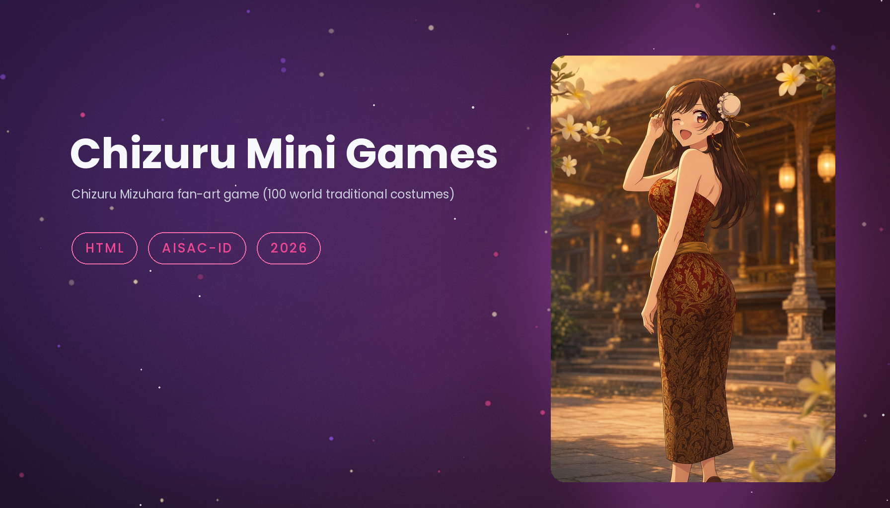
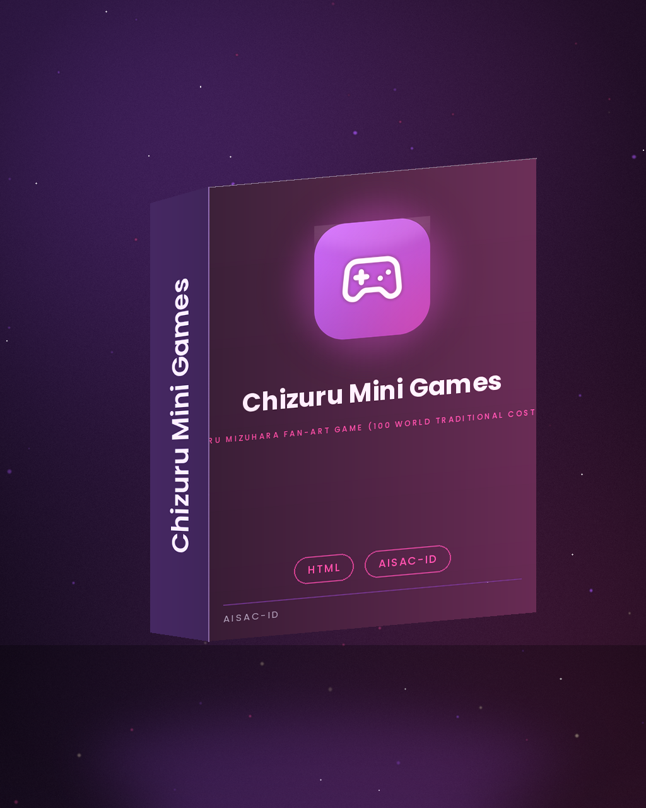
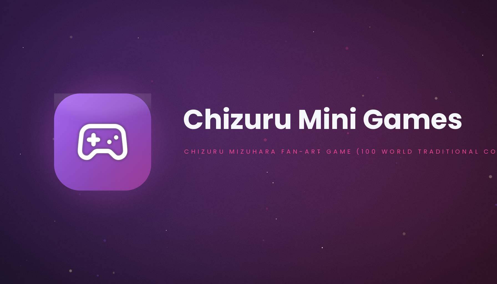
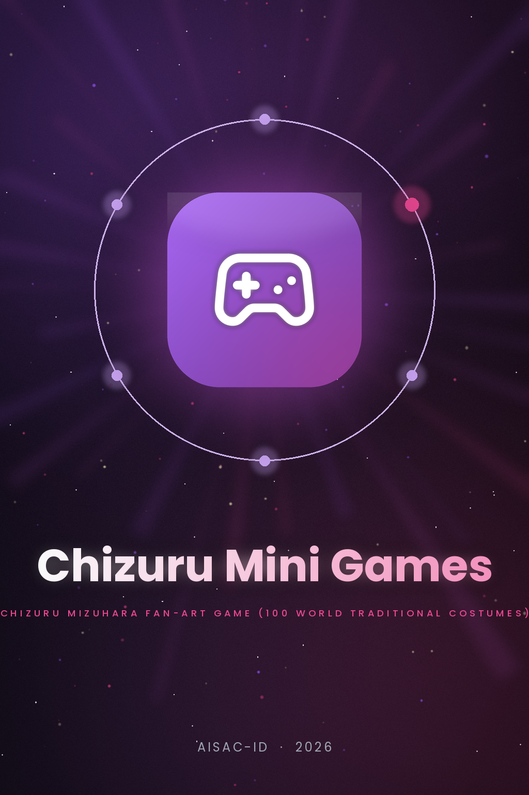
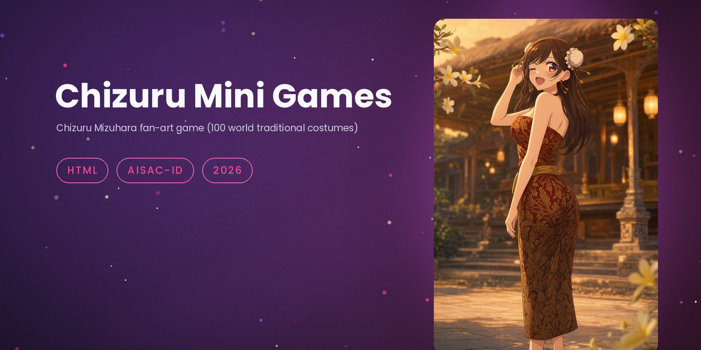
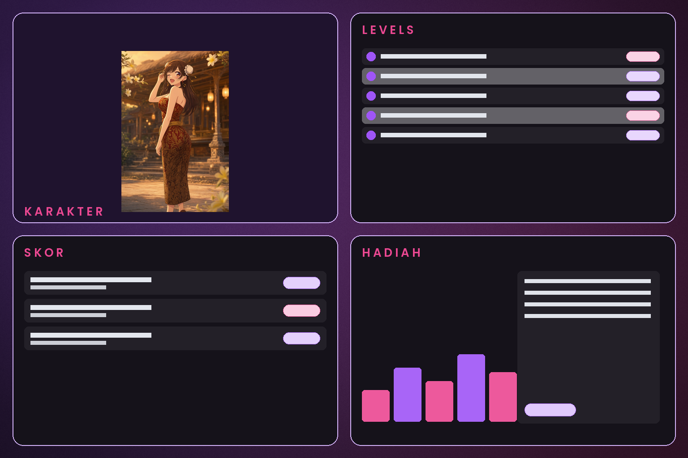

# Chizuru Mini Games

  

Tiga mini-game santai dengan Chizuru Mizuhara:

1. **Memory Match** — cari 8 pasang kartu kostum, hitung langkah.
2. **Sliding Puzzle** — puzzle geser 3×3, 4 pilihan gambar, tahan untuk preview.
3. **Idle Clicker** — tap untuk poin, beli upgrade (sepatu/sepeda/pesawat), unlock galeri kostum di tiap destinasi.

Progres disimpan di browser (localStorage).

## Mainkan
https://aisac-id.github.io/chizuru-mini-games/

## Teknis
Static HTML + JS, tanpa server. Buka `index.html` langsung atau via GitHub Pages.

---

## Brand & Promotion Kit

Aset branding resmi **Chizuru Mini Games** — logo, software box, poster, banner, dan materi sosial.
Semua aset berada di folder [`promo/`](promo/) dan bebas dipakai untuk materi promosi proyek ini.

  

| Aset | Pratinjau | Ukuran |
|---|---|---|
| Logo |  | 1024×1024 |
| Wordmark |  | 1600×500 |
| Software Box |  | 1600×1200 |
| Poster |  | 1200×1600 |
| Banner |  | 1920×820 |
| Social Preview |  | 1280×640 |
| Feature Showcase |  | 1600×1000 |
| Social Square |  | 1080×1080 |
