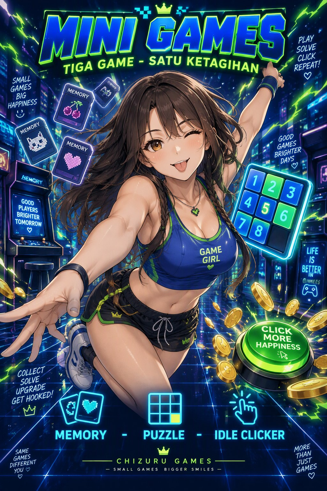

# Chizuru Mini Games

| Software Box | Poster |
|---|---|
|  |  |

| Social Preview | Social Square |
|---|---|
|  |  |

Tiga mini-game santai dengan Chizuru Mizuhara:

1. **Memory Match** — cari 8 pasang kartu kostum, hitung langkah.
2. **Sliding Puzzle** — puzzle geser 3x3, 4 pilihan gambar, tahan untuk preview.
3. **Idle Clicker** — tap untuk poin, beli upgrade (sepatu/sepeda/pesawat), unlock galeri kostum di tiap destinasi.

Progres disimpan di browser (localStorage).

## Mainkan
https://aisac-id.github.io/chizuru-mini-games/

## Teknis
Static HTML + JS, tanpa server. Buka `index.html` langsung atau via GitHub Pages.
Aset gambar fan-art di `assets/`, brand & promotion kit di `promo/`.
Bagian dari suite **CHIZURU GAMES** (4 game, 100 kostum) — video promo suite ada di arsip promo kit.
