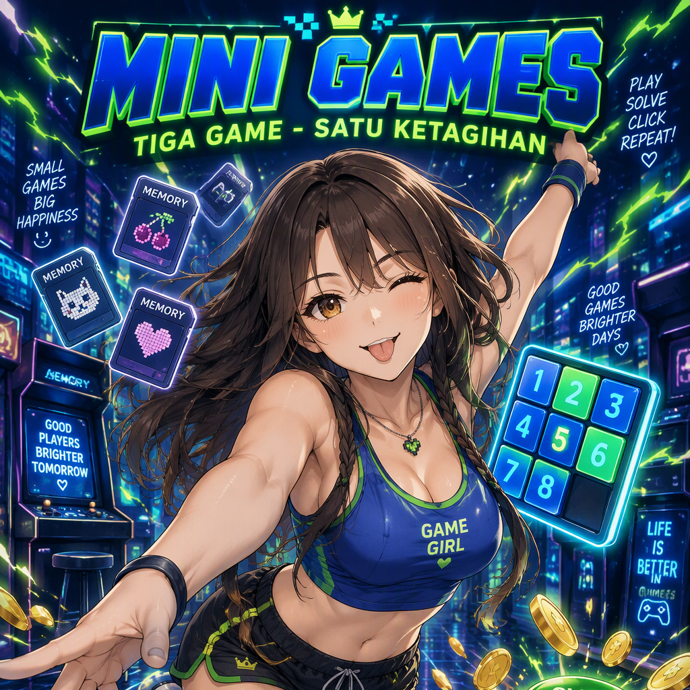

# Chizuru Mini Games

> **Fan-made, gratis, non-komersial.** Karya tidak resmi. Chizuru Mizuhara & Rent-A-Girlfriend © Reiji Miyajima/Kodansha. Tidak berafiliasi dengan, tidak disponsori, dan tidak didukung oleh Reiji Miyajima, Kodansha, atau pemegang hak lainnya. Pemegang hak dapat meminta takedown via issue repositori. [Disclaimer lengkap](#disclaimer) · [LICENSE (kode)](LICENSE) · [NOTICE (aset)](NOTICE.md)

| Software Box | Poster |
|---|---|
|  |  |

| Social Preview | Social Square |
|---|---|
|  |  |

Tiga mini-game santai dengan Chizuru Mizuhara:

1. **Memory Match** — cari 8 pasang kartu kostum, hitung langkah.
2. **Sliding Puzzle** — puzzle geser 3x3, 4 pilihan gambar, tahan untuk preview.
3. **Idle Clicker** — tap untuk poin, beli upgrade (sepatu/sepeda/pesawat), unlock galeri kostum di tiap destinasi.

Progres disimpan di browser (localStorage).

## Mainkan
https://aisac-id.github.io/chizuru-mini-games/

## Teknis
Static HTML + JS, tanpa server. Buka `index.html` langsung atau via GitHub Pages.
Aset gambar fan-art di `assets/`, brand & promotion kit di `promo/`.
Bagian dari suite **CHIZURU GAMES** (4 game, 100 kostum) — video promo suite ada di arsip promo kit.

## Disclaimer

### Bahasa Indonesia

> Proyek ini adalah karya fan-made tidak resmi, gratis, dan non-komersial. Karakter Chizuru Mizuhara dan Rent-A-Girlfriend © Reiji Miyajima/Kodansha. Proyek ini tidak berafiliasi dengan, tidak disponsori, dan tidak didukung oleh Reiji Miyajima, Kodansha, maupun pemegang hak lainnya. Seluruh hak karakter dan merek tetap milik pemiliknya. Tidak ada monetisasi, iklan, atau penjualan. Pemegang hak yang menginginkan konten ini diturunkan dapat menghubungi pemelihara repositori, dan konten akan dihapus secepatnya.

### English

> This is an unofficial fan-made project. It is free, non-commercial, and is not affiliated with, sponsored by, or endorsed by Reiji Miyajima, Kodansha, or any other rights holder. Chizuru Mizuhara and Rent-A-Girlfriend © Reiji Miyajima/Kodansha. All character and trademark rights remain with their respective owners. This project involves no monetization, advertising, or sales. Rights holders who want this content removed may contact the repository maintainer, and it will be taken down promptly.

**Lisensi:** kode sumber berlisensi [MIT](LICENSE) (copyright AISAC Indonesia). Aset gambar fan-art di `assets/` dan `promo/` **tidak** berlisensi MIT — lihat [NOTICE.md](NOTICE.md). Kanal takedown & laporan keamanan: [SECURITY.md](SECURITY.md) (respons 24–48 jam).
